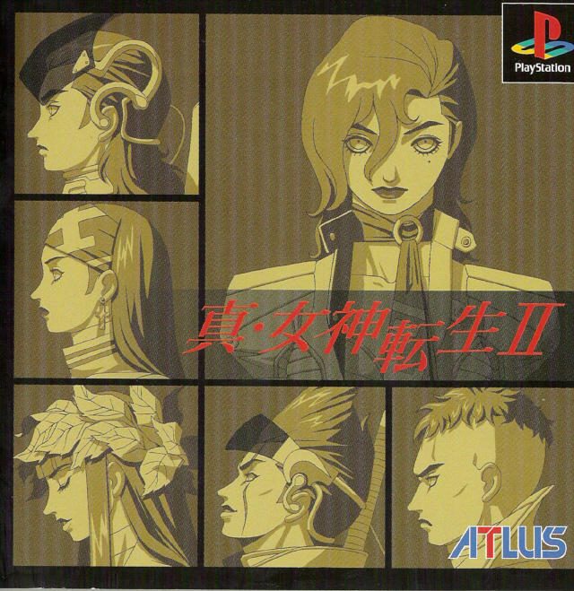

<p align="center">
  
</p>

<p align="center">
  <a href="SUIVI.md"></a>
  <a href="https://discord.gg/anbTYCsK7Y"></a>
  <a href="https://discord.gg/s6CRadvPa3"></a>
  <a href="https://github.com/Roman215/smt2-psx-translation"></a>
</p>



**Fan-traduction française de *Shin Megami Tensei II*** sur PlayStation
(version japonaise `SLPM-86924`, Rev 1).

Sorti sur Super Famicom en 1994 puis refait sur PlayStation en 2002, le jeu
n'a jamais quitté le Japon. Ce projet vise une version **complète, jouable et
écrite en vrai français**, accents compris, sur la base du remarquable
travail de **[Roman215](https://github.com/Roman215/smt2-psx-translation)**,
qui a traduit le jeu en anglais et en a écrit toute la chaîne d'outils.

Tokyo, bien des années après la Grande Destruction. Un combattant sans
mémoire que l'on appelle Hawk se réveille dans les bas-fonds de Valhalla,
à l'ombre du Centre et de son Millénium promis. Entre la Loi des Messiens,
le Chaos des Gaïens et ceux qui refusent l'un comme l'autre, c'est à lui de
choisir.

<br clear="right">


## Avancement

<!-- avancement:debut -->
```text
Dialogues      █░░░░░░░░░░░░░░░░░░░░░░░    5 %      253 / 4 914 textes
Système        ░░░░░░░░░░░░░░░░░░░░░░░░    0 %        0 / 554 textes
Menus          ██████████░░░░░░░░░░░░░░   42 %      107 / 249 textes
Noms           █░░░░░░░░░░░░░░░░░░░░░░░    4 %       48 / 1 114 textes
Cartes         ░░░░░░░░░░░░░░░░░░░░░░░░    0 %        0 / 142 textes
Équipe         ████████████████████████  100 %        7 / 7 textes

Total          █░░░░░░░░░░░░░░░░░░░░░░░    5 %      415 / 6 980 textes
```
<!-- avancement:fin -->

Le détail par fichier est dans **[SUIVI.md](SUIVI.md)**, mis à jour
automatiquement à chaque fusion. Ce qui reste à faire, et dans quel ordre,
est écrit dans la **[feuille de route](docs/FEUILLE_DE_ROUTE.md)**.

> [!NOTE]
> Une ligne pas encore traduite s'affiche en anglais. Le patch reste donc
> jouable de bout en bout à chaque étape, et chaque ligne traduite se voit
> tout de suite en jeu.


## Participer

Toute aide est la bienvenue : traduction, relecture, tests en jeu.

1. **Rejoins le Discord [MegaTen \[FR\]](https://discord.gg/anbTYCsK7Y)** :
   c'est là qu'on se répartit les fichiers, pour que deux personnes ne
   traduisent pas la même page.
2. **Lis le [guide de contribution](CONTRIBUTING.md)**, puis le
   **[Dictionnaire](docs/Dictionnaire.md)**. Un terme se traduit toujours de
   la même façon d'un bout à l'autre du jeu.
3. **Ouvre un fichier de [`trad/`](trad/)** et remplis les champs `"fr"`.
   Rien d'autre à toucher, et rien à installer : ça marche aussi depuis le
   navigateur de GitHub.

```json
{
  "id": "0x01d0",
  "en": "{PG}Okamoto: Enough loafing around.{CR}Get in the Virtual Trainer.{WT}{ED}",
  "fr": "{PG}Okamoto: Assez flâné.{CR}Va dans le Simulateur virtuel.{WT}{ED}"
}
```

Chaque proposition est vérifiée automatiquement : balises de contrôle,
caractères disponibles dans la police, longueur des lignes, respect du
dictionnaire. Les erreurs s'affichent directement sur les lignes de la
Pull Request.


## Organisation du dépôt

```text
trad/          ← le texte à traduire, en JSON (c'est le seul dossier à modifier)
  dialogues/     4 914 répliques, une page par tranche de 256 messages
  systeme/       sauvegarde, COMP, aide, boutiques
  menus/         commandes et choix de négociation
  noms/          démons, races, sorts, objets, lieux, PNJ, boissons, affinités
  cartes/        noms de zones (écran de sauvegarde, automap)
  equipe/        noms par défaut du groupe
amont/         ← la traduction anglaise de Roman215 (sous-module, version figée)
outils/        ← extraire, valider, injecter, stats
police/        ← accents français : jeu de caractères, composition des glyphes
docs/          ← dictionnaire, feuille de route, notes techniques
```

Le code de Roman215 n'est **jamais recopié ni modifié à la main** :
`outils/injecter.py` repère chaque texte anglais dans ses fichiers et le
remplace par le français au moment du build. Une nouvelle version anglaise
se récupère en une commande (voir [docs/TECHNIQUE.md](docs/TECHNIQUE.md)).


## Construire le patch

> [!IMPORTANT]
> Il faut **ta propre copie** de *Shin Megami Tensei II (Japan) (Rev 1)*, en
> image BIN (MODE2/2352, 222 694 416 octets). Ce dépôt ne contient et ne
> télécharge aucune donnée du jeu.

```powershell
git clone --recursive https://github.com/Grimoire-du-Coeur/SMT-II-FR-PSX.git
cd SMT-II-FR-PSX
python outils/injecter.py                # -> build/smt2-fr/
cd build/smt2-fr
python build.py --input "C:\chemin\vers\Shin Megami Tensei II (Japan) (Rev 1).bin"
```

Il faut Python 3.10 ou plus récent. Les options du build (vidéos,
gameplay amélioré, patch xdelta) sont celles de Roman215 : voir le
[README anglais](https://github.com/Roman215/smt2-psx-translation#readme).

Les versions publiques seront distribuées uniquement sous forme de **patch
xdelta**, à appliquer avec [Delta Patcher](https://github.com/marco-calautti/DeltaPatcher/releases).


## Mentions légales

Ce dépôt ne distribue **aucun contenu appartenant à Atlus** : ni image
disque, ni exécutable, ni musique, ni vidéo, ni police ou graphisme
d'origine. Il contient uniquement le texte de la traduction, les outils et
la documentation. Un contrôle automatique refuse tout fichier de jeu.

*Shin Megami Tensei II* et tous les éléments qui s'y rattachent
appartiennent à **Atlus / SEGA**. Ce projet est gratuit, réalisé par des
fans, sans aucun but commercial.

- Outils de ce dépôt : licence [MIT](LICENSE).
- Texte français (`trad/`) : licence [CC BY-NC-SA 4.0](LICENSE).
- Traduction anglaise et chaîne de build de Roman215 : licence MIT, voir
  [`amont/LICENSE`](https://github.com/Roman215/smt2-psx-translation/blob/master/LICENSE).


## Crédits

| | |
|---|---|
| **Lead du projet, traduction, police française** | [gc-ultimate117](https://github.com/gc-ultimate117) |
| **Traduction anglaise, outils, rétro-ingénierie** | [Roman215](https://github.com/Roman215) et les contributeurs du projet original |
| **Organisation, relecture, tests** | les membres de [MegaTen \[FR\]](https://discord.gg/anbTYCsK7Y) |
| **Hébergement, outillage du dépôt** | le [Grimoire du Cœur](https://github.com/Grimoire-du-Coeur) |

Un immense merci à **Roman215**, sans qui cette version n'existerait pas,
ainsi qu'à toute la communauté Megami Tensei et aux développeurs d'outils
de romhacking qui rendent ce genre de projet possible.
